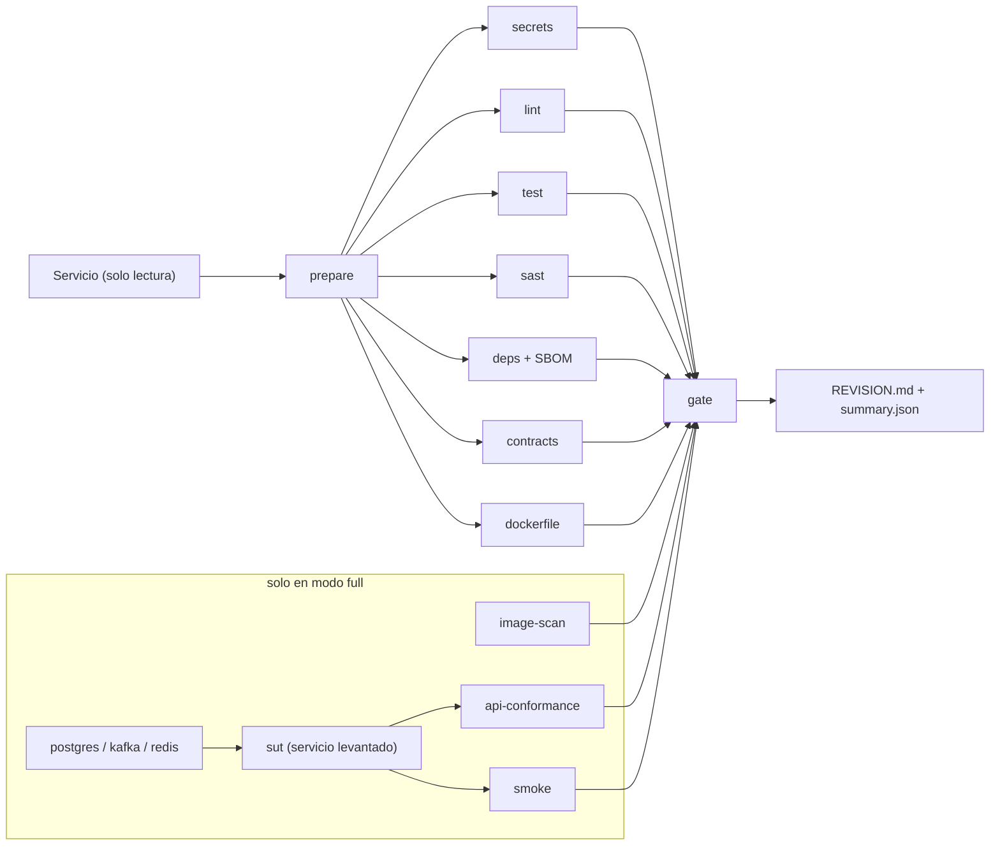
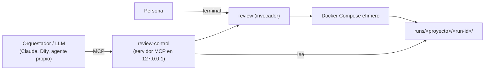

# Pipeline de revisión efímero — definición v1.1

> **Qué es:** la especificación de un pipeline que hace la **revisión completa de un servicio** levantándose como un
> **Docker Compose efímero**: se crea para una corrida, revisa, deja un informe y se destruye sin dejar rastro.
> **Estado:** diseño listo para implementar. El Compose y los scripts de este documento son la referencia de diseño;
> **todavía no se han ejecutado** (ver [Plan de implementación](#13-plan-de-implementación)).
> **Origen:** extraído y madurado del pipeline del proyecto `bodega-cv` (2026-10-07). No depende de ese proyecto.

---

## 1. Objetivo y alcance

**Una orden, un servicio, un veredicto.**

```
review <ruta-del-servicio> [--mode quick|full] [--base <ref-git>]
```

- **Entrada:** la carpeta de un servicio (con su `Dockerfile` y, si los tiene, sus contratos).
- **Salida:** `runs/<servicio>/<run-id>/REVISION.md` (informe legible), `summary.json` (para máquinas) y los reportes
  crudos de cada herramienta. Código de salida `0` aprobado, `1` rechazado, `2` la revisión no pudo completarse.
- **Efímero:** red, contenedores, volúmenes e imagen del servicio se crean con un nombre único por corrida y se
  eliminan al terminar, pase o falle. Lo único que persiste es la carpeta del informe y las cachés de dependencias.

**Fuera de alcance (a propósito):** desplegar, publicar imágenes, publicar contratos o documentación. El pipeline
revisa; la entrega es otro proceso que **consume** el veredicto.

## 2. Lecciones del pipeline original

Lo que se conserva del pipeline de `bodega-cv` y lo que se corrige.

| En el original | Problema | En esta definición |
| --- | --- | --- |
| Un workflow de Gitea Actions por repo, copiado de una plantilla | Los 13 workflows divergieron; el frontend quedó sin ninguno | **Una sola definición** parametrizada por servicio; el CI solo la invoca |
| Dependía de Gitea + `act_runner` + OpenShift | Al apagar el servidor, la revisión dejó de existir | Corre con Docker y nada más, en cualquier PC o runner |
| `mvn ... -DskipTests=true` en CFS | El pipeline aprobaba sin ejecutar pruebas | Las pruebas son una etapa obligatoria; no ejecutarlas es `error`, no `pass` |
| `npm audit ... \|\| true`, `govulncheck ... \|\| echo`, `gosec ... \|\| echo` | Los escaneos de seguridad nunca bloqueaban | Ninguna etapa oculta su resultado; lo que bloquea lo decide **una política explícita** |
| Herramientas instaladas con `@latest` o `:latest` | Corridas no reproducibles | Todas las imágenes fijadas por versión (ideal: por digest) |
| Revisión y despliegue en la misma cadena | Un fallo de despliegue se confundía con un fallo de calidad | Solo revisión |
| Contratos "siempre sincronizados" como regla escrita | Nadie la verificaba hasta la prueba funcional manual | Etapa de contratos: lint, cambios incompatibles y conformidad en ejecución |
| `REVISION.md` escrito a mano por un agente, sin volver a verificarse | Hallazgos sin seguimiento | `REVISION.md` generado en cada corrida, con identificadores estables y excepciones con vencimiento |
| Revisión del PR sin imposición por herramienta | Dependía de la disciplina | El veredicto es un artefacto verificable (`summary.json`) que el CI puede exigir |

## 3. Principios

1. **Efímero y aislado.** Proyecto de Compose con nombre único, red propia, **ningún puerto publicado** al host. Nunca
   toca otro stack que esté corriendo en el equipo.
2. **El código fuente se monta en solo lectura.** Las etapas trabajan sobre una copia en un volumen de la corrida.
3. **Todas las etapas corren siempre.** Una etapa que encuentra problemas no detiene a las demás; se informa todo de
   una vez. El veredicto lo da una sola pieza al final (`gate`).
4. **No ejecutado no es aprobado.** Estados posibles de una etapa: `pass`, `fail` (hay hallazgos), `error` (la
   herramienta no pudo correr), `skipped` (no aplica y está declarado). `error` rechaza la corrida.
5. **La política vive en un archivo**, no en los comandos. Prohibido `|| true`.
6. **Reproducible.** Mismas versiones de herramientas, mismas reglas, mismo resultado.
7. **Agnóstico del lenguaje.** Lo específico de cada stack se reduce a una imagen y cuatro comandos.
8. **El CI es un invocador.** Local y CI ejecutan exactamente la misma orden.

## 4. Arquitectura



- Cada caja es un **servicio de Compose de una sola ejecución**.
- Las etapas estáticas dependen de `prepare` y corren en paralelo.
- `gate` depende de que todas hayan **terminado**; lee sus resultados, aplica la política y devuelve el código de salida.
- La orden que dispara todo es `docker compose run --rm gate`: Compose levanta las dependencias, espera y devuelve
  el código de `gate`. (No usar `up --exit-code-from`: implica `--abort-on-container-exit` y mataría las demás etapas
  cuando termine la primera.)

### Modos

| Modo | Qué incluye | Uso |
| --- | --- | --- |
| `quick` | `prepare`, `secrets`, `lint`, `test`, `sast`, `deps`, `contracts`, `dockerfile`, `gate` | Antes de cada commit o PR; minutos |
| `full` | Lo anterior + construir la imagen, `image-scan`, levantar el servicio con sus dependencias, `api-conformance`, `smoke` | Antes de fusionar o liberar |

`quick` usa solo `compose.yml`. `full` agrega `compose.runtime.yml` y los fragmentos de dependencias. Son archivos
superpuestos y no perfiles, porque `gate` debe depender de etapas que solo existen en `full`.

## 5. Catálogo de etapas

| # | Etapa | Herramienta | Qué revisa | Bloquea por defecto cuando |
| --- | --- | --- | --- | --- |
| 0 | `prepare` | git + sh | Copia el código al volumen, registra commit y rama, detecta el stack, calcula el diff contra `--base` | No puede preparar (→ `error`, exit 2) |
| 1 | `secrets` | Gitleaks | Secretos en el árbol y en el historial de git | Cualquier hallazgo |
| 2 | `lint` | Del stack | Formato y análisis estático del lenguaje | El comando falla |
| 3 | `test` | Del stack | Compilación, pruebas unitarias, cobertura | Falla una prueba, hay 0 pruebas, o cobertura bajo el umbral |
| 4 | `sast` | Semgrep (+ el SAST del stack si existe) | Patrones de vulnerabilidad en el código | Severidad alta o superior |
| 5 | `deps` | Trivy (`fs`) | CVE en dependencias, licencias; genera SBOM CycloneDX | CVE crítico o alto **con corrección disponible** |
| 6 | `contracts` | Spectral, Buf, oasdiff | Lint de OpenAPI, AsyncAPI y `.proto`; cambios incompatibles contra `--base` | Contrato inválido o cambio incompatible sin subir versión mayor |
| 7 | `dockerfile` | Hadolint | Buenas prácticas del `Dockerfile` | Reglas de nivel error |
| 8 | `image-scan` | Trivy (`image`) | CVE del sistema base y de la imagen final; usuario root; tamaño | CVE crítico con corrección; corre como root |
| 9 | `api-conformance` | Schemathesis | El servicio levantado responde como dice su OpenAPI (códigos, esquemas, sin 5xx) | Respuesta 5xx o fuera de esquema |
| 10 | `smoke` | k6 (script del servicio) | Flujo mínimo de negocio, salud, cabeceras obligatorias | Falla un `check` |
| 11 | `ai-review` (opcional) | LLM local o remoto | Revisión de diseño sobre el diff: transacciones, concurrencia, alineación de eventos | **Nunca bloquea**; solo aporta hallazgos al informe |
| 12 | `gate` | Python | Agrega resultados, aplica política y excepciones, escribe el informe | — |

Notas:
- Si el servicio no tiene contratos, `contracts` y `api-conformance` quedan `skipped` solo si `.review.env` lo declara
  (`CONTRACTS=none`). Que falten sin declararlo es `error`.
- La paridad REST/gRPC es un punto de extensión de `smoke`: el script carga el `.proto` y compara ambos protocolos.
- `ai-review` existe porque los hallazgos más graves del proyecto de origen (outbox no transaccional, campos de
  evento desalineados) no los detecta ninguna herramienta estática. Es consultiva: un modelo no decide el veredicto.

## 6. Perfiles de stack

Cada stack es un archivo `stacks/<stack>.env` con una imagen y cuatro comandos. Agregar un lenguaje es agregar un archivo.

| Stack | Detección | Imagen | `LINT_CMD` | `TEST_CMD` | Caché |
| --- | --- | --- | --- | --- | --- |
| `java` | `pom.xml` | `eclipse-temurin:21-jdk` | `./mvnw -B spotless:check` | `./mvnw -B verify` | `~/.m2` |
| `go` | `go.mod` | `golang:<mayor.menor>` según la directiva `go` del `go.mod` del servicio (`go 1.26.0` -> `golang:1.26`); si no se puede leer, `IMG_GOLANG` de `versions.env` (`golang:1.26`) | `gofmt -l .` (lista los archivos, sin código generado) y `go vet ./...` | `go test -v -race -coverprofile=/out/coverage.raw ./...`, filtro de código generado (`*.pb.go` y archivos con cabecera `// Code generated ... DO NOT EDIT.`) y `go tool cover -func=/out/coverage.out` | `GOMODCACHE` |
| `node` | `package.json` | `node:22` | `npm ci && npm run lint && npx tsc --noEmit` | `npm test -- --coverage` | `~/.npm` |
| `ruby` | `Gemfile` | `ruby:3.3` | `bundle install && bundle exec rubocop` | `bundle exec rspec` | `vendor/bundle` |
| `python` / `python_mcp` | `pyproject.toml` / `requirements.txt` / `setup.py` / `setup.cfg` / `Pipfile` | `.python-version` o `requires-python` → `python:<x.y>-slim` (si no, `IMG_PYTHON_STACK`) | `ruff check` + `ruff format --check` (base en `tools/lint/rules/python/ruff.toml` si el servicio no trae la suya) y `mypy` si está configurado | `pytest` + `pytest-cov` (cobertura de ramas, `junit.xml` y `coverage.json`) | `~/.cache/pip` |

Ejemplo, `stacks/go.env`:

```dotenv
STACK=go
TOOLCHAIN_IMAGE=golang:1.26
LINT_CMD=test -z "$(gofmt -l .)" && go vet ./...
TEST_CMD=go test -race -coverprofile=/out/test/coverage.out -covermode=atomic ./...
STACK_SAST_CMD=go run github.com/securego/gosec/v2/cmd/gosec@v2.21.4 -fmt sarif -out /out/sast/gosec.sarif ./...
CACHE_PATH=/go/pkg/mod
```

## 7. Contrato del servicio revisado

El servicio aporta, como máximo, tres cosas. Las tres son opcionales; sin ellas corre el modo `quick` con valores por defecto.

**`.review.env`** en la raíz del servicio: ajustes sobre el perfil del stack.

```dotenv
SERVICE_NAME=yard-dispatch-service
STACK=node                       # si se omite, se detecta
CONTRACTS_DIR=contracts/v1       # o CONTRACTS=none
OPENAPI_FILE=contracts/v1/yard_dispatch.yaml
COVERAGE_MIN=60
# modo full
SUT_PORT=8084
SUT_HEALTH_PATH=/health
SUT_DEPS=postgres,kafka,redis
SMOKE_SCRIPT=review/smoke.js
```

**`review/sut.env`**: variables de entorno del servicio cuando se levanta para la revisión. Solo credenciales
desechables que apuntan a las dependencias efímeras (`postgres`, `kafka`, `redis` por nombre de red). Nunca secretos reales.

**`review/smoke.js`**: script de k6 con el flujo mínimo.

Requisitos del servicio para el modo `full`: un `Dockerfile` que construya solo, un endpoint de salud, y arrancar con
las variables de `sut.env` sin depender de nada fuera de la red de la corrida.

## 8. Contrato de resultados

Cada etapa escribe en `/out/<etapa>/`:

- el reporte nativo de la herramienta (SARIF cuando existe, JSON o JUnit si no);
- `stage.log` con la salida completa;
- `result.json`:

```json
{
  "stage": "deps",
  "status": "fail",
  "tool": "trivy",
  "tool_version": "0.57.1",
  "exit_code": 1,
  "duration_s": 41,
  "reports": ["report.sarif", "sbom.cdx.json"]
}
```

El envoltorio `lib/stage.sh` es quien lo escribe: ejecuta el comando con límite de tiempo, guarda el log, traduce el
código de salida a `pass` / `fail` / `error` y **termina siempre en 0** para que las demás etapas sigan. Convención:
código `1` = hallazgos (`fail`); cualquier otro distinto de 0, o tiempo agotado = `error`.

`gate` normaliza los reportes a una lista única de hallazgos:

```json
{ "id": "deps:CVE-2024-12345:pkg/x@1.2.3", "stage": "deps", "severity": "high",
  "rule": "CVE-2024-12345", "file": "go.sum", "line": null, "message": "...", "fix": "1.2.4", "waived": false }
```

El `id` es estable entre corridas: permite seguir un hallazgo y referirlo en una excepción.

## 9. Política y excepciones

`policy.yaml` (del pipeline; un servicio puede endurecerla, no relajarla):

```yaml
version: 1
stages:
  secrets:   { block_on: any }
  lint:      { block_on: fail }
  test:      { block_on: fail, coverage_min: 60, require_tests: true }
  sast:      { block_on: high }
  deps:      { block_on: high, only_fixable: true, licenses_denied: [AGPL-3.0, SSPL-1.0] }
  contracts: { block_on: fail, breaking_changes: block }
  dockerfile: { block_on: error }
  image-scan: { block_on: critical, only_fixable: true, forbid_root: true }
  api-conformance: { block_on: fail }
  smoke:     { block_on: fail }
  ai-review: { block_on: never }
on_stage_error: block        # una etapa que no pudo correr rechaza la corrida
on_missing_stage: block      # una etapa esperada sin result.json rechaza la corrida
```

`waivers.yaml` (en el repo del servicio): la única forma legítima de aceptar un hallazgo.

```yaml
- id: "deps:CVE-2024-12345:pkg/x@1.2.3"
  reason: "No hay versión corregida compatible; el camino vulnerable no se usa"
  owner: spino
  expires: 2026-12-31
```

Reglas: toda excepción tiene motivo, responsable y vencimiento. Vencida, el hallazgo vuelve a bloquear. Las
excepciones aplicadas aparecen en el informe; no se pueden exceptuar `secrets` ni los estados `error`.

## 10. Informe

`REVISION.md`, generado por `gate`:

```markdown
# Revisión — yard-dispatch-service
Veredicto: RECHAZADO · modo full · commit 4f2a9c1 (feat/slots) · base main · 2026-10-07 15:12 · 6 min 40 s

## Resumen
| Etapa | Estado | Crítico | Alto | Medio | Bajo | Exceptuados |
| secrets | pass | 0 | 0 | 0 | 0 | 0 |
| test | pass (87 pruebas, cobertura 71 %) | … |
| deps | fail | 0 | 2 | 5 | 1 | 1 |

## Hallazgos que bloquean
### deps:CVE-…  · ALTO · go.sum
Qué es · Dónde · Cómo corregir (versión corregida)

## Hallazgos que no bloquean
## Excepciones aplicadas (con vencimiento)
## Revisión asistida por IA (consultiva)
## Qué no se revisó y por qué
```

La última sección es obligatoria: lista las etapas `skipped` y los límites de la corrida, para que un informe en
verde no se lea como más de lo que es.

`summary.json` lleva lo mismo en forma estructurada (`verdict`, `mode`, `commit`, conteos por etapa y severidad,
versiones de herramientas, hash de `policy.yaml`).

## 11. Compose de referencia y Arquitectura de Implementación

> **Nota de implementación:** el diseño original describe las etapas orquestadas mediante Docker Compose. La implementación real utiliza un motor desacoplado en Python (`PipelineEngine` y `DockerRunner`) que invoca contenedores efímeros aislados por etapa (`tools/<etapa>/tool.py`), gobernados por `policy.yaml` y reportados mediante `core/reporter.py`. Esta arquitectura permite exponer cada herramienta como un servidor MCP interactivo y facilita la ejecución portable en entornos Windows/Linux sin dependencia de shell scripts complejos.

Estructura del proyecto:

```
Pipeline/
├── PIPELINE_REVISION.md      # este documento
├── review.ps1 / review.sh    # invocador
├── compose.yml               # etapas estáticas + gate
├── compose.runtime.yml       # modo full
├── deps/{postgres,kafka,redis}.yml
├── stacks/{java,go,node,ruby,python}.env
├── versions.env              # imágenes fijadas
├── policy.yaml
├── projects.yaml             # registro de proyectos revisables (sección 17)
├── control/                  # imagen review-control: gate + servidor MCP
├── rules/                    # reglas propias de Semgrep y Spectral
├── lib/{prepare.sh,stage.sh,gate.py}
└── runs/                     # informes (ignorado por git)
```

`compose.yml` (abreviado; las etapas que faltan siguen el mismo molde):

```yaml
name: review-${SERVICE_NAME}-${RUN_ID}

x-stage: &stage
  working_dir: /src
  networks: [review]
  volumes:
    - workspace:/src
    - ${RUN_DIR}:/out
    - ./lib:/opt/review:ro
    - ./rules:/opt/rules:ro
  entrypoint: ["/bin/sh", "/opt/review/stage.sh"]
  depends_on:
    prepare: { condition: service_completed_successfully }

services:
  prepare:
    image: ${IMG_GIT}
    networks: [review]
    volumes:
      - ${SERVICE_DIR}:/input:ro
      - workspace:/src
      - ${RUN_DIR}:/out
      - ./lib:/opt/review:ro
    environment: { BASE_REF: "${BASE_REF:-}" }
    entrypoint: ["/bin/sh", "/opt/review/prepare.sh"]

  secrets:
    <<: *stage
    image: ${IMG_GITLEAKS}
    environment: { STAGE: secrets, STAGE_TIMEOUT: 300 }
    command: ["gitleaks git /src --redact --no-banner --report-format sarif --report-path /out/secrets/report.sarif"]

  lint:
    <<: *stage
    image: ${TOOLCHAIN_IMAGE}
    environment: { STAGE: lint, STAGE_TIMEOUT: 900 }
    command: ["${LINT_CMD}"]
    volumes:
      - workspace:/src
      - ${RUN_DIR}:/out
      - ./lib:/opt/review:ro
      - cache:${CACHE_PATH}

  test:
    <<: *stage
    image: ${TOOLCHAIN_IMAGE}
    environment: { STAGE: test, STAGE_TIMEOUT: 1800 }
    command: ["${TEST_CMD}"]
    volumes:
      - workspace:/src
      - ${RUN_DIR}:/out
      - ./lib:/opt/review:ro
      - cache:${CACHE_PATH}

  sast:
    <<: *stage
    image: ${IMG_SEMGREP}
    environment: { STAGE: sast, STAGE_TIMEOUT: 900 }
    command: ["semgrep scan --config /opt/rules/semgrep --error --sarif --output /out/sast/report.sarif /src"]

  deps:
    <<: *stage
    image: ${IMG_TRIVY}
    environment: { STAGE: deps, STAGE_TIMEOUT: 900 }
    command: ["trivy fs --scanners vuln,license --format sarif --output /out/deps/report.sarif --exit-code 1 /src && trivy fs --format cyclonedx --output /out/deps/sbom.cdx.json /src"]
    volumes:
      - workspace:/src
      - ${RUN_DIR}:/out
      - ./lib:/opt/review:ro
      - trivy-db:/root/.cache/trivy

  # contracts (Spectral + Buf + oasdiff) y dockerfile (Hadolint): mismo molde.

  gate:
    image: ${IMG_PYTHON}
    networks: [review]
    volumes:
      - ${RUN_DIR}:/out
      - ./lib:/opt/review:ro
      - ./policy.yaml:/opt/policy.yaml:ro
      - ${SERVICE_DIR}:/input:ro           # para leer waivers.yaml
    environment: { MODE: "${MODE}", EXPECTED_STAGES: "${EXPECTED_STAGES}" }
    entrypoint: ["python", "/opt/review/gate.py"]
    depends_on:
      secrets: { condition: service_completed_successfully }
      lint:    { condition: service_completed_successfully }
      test:    { condition: service_completed_successfully }
      sast:    { condition: service_completed_successfully }
      deps:    { condition: service_completed_successfully }

networks:
  review: {}

volumes:
  workspace: {}                             # se destruye con la corrida
  cache:    { external: true, name: "review-cache-${STACK}" }   # persiste entre corridas
  trivy-db: { external: true, name: "review-trivy-db" }
```

`compose.runtime.yml` (modo `full`):

```yaml
services:
  sut:
    build: { context: "${SERVICE_DIR}" }
    image: review/${SERVICE_NAME}:${RUN_ID}
    networks: [review]
    env_file: ["${SUT_ENV_FILE}"]
    healthcheck:
      test: ["CMD-SHELL", "wget -qO- http://localhost:${SUT_PORT}${SUT_HEALTH_PATH} || exit 1"]
      interval: 5s
      retries: 30
    # sin 'ports:': solo es alcanzable dentro de la red de la corrida

  image-scan:
    image: ${IMG_TRIVY}
    networks: [review]
    volumes: ["${RUN_DIR}:/out", "./lib:/opt/review:ro", "trivy-db:/root/.cache/trivy"]
    environment: { STAGE: image-scan, STAGE_TIMEOUT: 900 }
    entrypoint: ["/bin/sh", "/opt/review/stage.sh"]
    command: ["trivy image --input /out/image.tar --format sarif --output /out/image-scan/report.sarif --exit-code 1"]

  api-conformance:
    image: ${IMG_SCHEMATHESIS}
    networks: [review]
    volumes: ["workspace:/src", "${RUN_DIR}:/out", "./lib:/opt/review:ro"]
    environment: { STAGE: api-conformance, STAGE_TIMEOUT: 900 }
    entrypoint: ["/bin/sh", "/opt/review/stage.sh"]
    command: ["schemathesis run /src/${OPENAPI_FILE} --url http://sut:${SUT_PORT} --checks all --report junit --report-dir /out/api-conformance"]
    depends_on:
      prepare: { condition: service_completed_successfully }
      sut:     { condition: service_healthy }

  smoke:
    image: ${IMG_K6}
    networks: [review]
    volumes: ["workspace:/src", "${RUN_DIR}:/out", "./lib:/opt/review:ro"]
    environment: { STAGE: smoke, STAGE_TIMEOUT: 600, BASE_URL: "http://sut:${SUT_PORT}" }
    entrypoint: ["/bin/sh", "/opt/review/stage.sh"]
    command: ["k6 run --summary-export /out/smoke/summary.json /src/${SMOKE_SCRIPT}"]
    depends_on:
      sut: { condition: service_healthy }

  gate:
    depends_on:
      image-scan:      { condition: service_completed_successfully }
      api-conformance: { condition: service_completed_successfully }
      smoke:           { condition: service_completed_successfully }
```

Fragmento de dependencia, `deps/postgres.yml` (se agrega con `-f` si está en `SUT_DEPS`):

```yaml
services:
  postgres:
    image: ${IMG_POSTGRES}
    networks: [review]
    environment: { POSTGRES_USER: review, POSTGRES_PASSWORD: review, POSTGRES_DB: review }
    tmpfs: [/var/lib/postgresql/data]       # datos en memoria: nada que limpiar
    healthcheck: { test: ["CMD-SHELL", "pg_isready -U review"], interval: 3s, retries: 20 }
  sut:
    depends_on:
      postgres: { condition: service_healthy }
```

`lib/stage.sh` (esqueleto):

```sh
#!/bin/sh
# Ejecuta el comando de la etapa y SIEMPRE termina en 0; el estado real queda en result.json.
mkdir -p "/out/$STAGE"; start=$(date +%s)
timeout "${STAGE_TIMEOUT:-900}" sh -c "$*" > "/out/$STAGE/stage.log" 2>&1; code=$?
case $code in 0) status=pass ;; 1) status=fail ;; *) status=error ;; esac
printf '{"stage":"%s","status":"%s","exit_code":%s,"duration_s":%s}\n' \
  "$STAGE" "$status" "$code" "$(( $(date +%s) - start ))" > "/out/$STAGE/result.json"
exit 0
```

Requiere imágenes con `sh` y `timeout` (variantes Alpine o Debian; la imagen `scratch` de Hadolint no sirve, usar
la `-alpine`). Alternativa si eso molesta: una sola imagen propia `review-tools` con todas las herramientas fijadas.

## 12. Invocador

Secuencia que implementan `review.ps1` y `review.sh`:

1. Resolver `SERVICE_DIR`, `SERVICE_NAME`, `MODE`, `BASE_REF`. Detectar `STACK` si no viene declarado.
2. `RUN_ID = <aaaammdd-hhmmss>-<sha corto>`; crear `RUN_DIR = runs/<servicio>/<RUN_ID>`.
3. Crear, si no existen, los volúmenes de caché (`review-cache-<stack>`, `review-trivy-db`).
4. Armar los argumentos: `--env-file versions.env --env-file stacks/<stack>.env --env-file <servicio>/.review.env`,
   `-f compose.yml` y, en `full`, `-f compose.runtime.yml -f deps/<cada dependencia>.yml`.
5. En `full`: `docker compose build sut` y `docker save review/<servicio>:<RUN_ID> -o <RUN_DIR>/image.tar`.
6. `docker compose run --rm gate` → guardar su código de salida.
7. **Siempre** (bloque `finally` / `trap`): `docker compose down -v --remove-orphans`, borrar la imagen
   `review/<servicio>:<RUN_ID>` y `image.tar`.
8. Imprimir el veredicto y la ruta de `REVISION.md`; salir con el código de `gate`.

El `down -v` actúa solo sobre el proyecto `review-<servicio>-<RUN_ID>`; las cachés sobreviven porque son volúmenes
externos. Dos corridas simultáneas no chocan: nombre de proyecto distinto y ningún puerto en el host.

Desde un CI, el trabajo completo es una línea:

```yaml
- run: ./review.sh . --mode full --base origin/main
- uses: actions/upload-artifact@v4
  if: always()
  with: { name: revision, path: runs/ }
```

Notas para Windows (PowerShell 5.1): scripts solo ASCII, rutas con `/` al pasarlas a Compose, y anteponer
`C:\Program Files\Docker\Docker\resources\bin` al `PATH` si `docker` no se encuentra.

## 13. Plan de implementación

| Fase | Entrega | Criterio de aceptación |
| --- | --- | --- |
| 1. Esqueleto | `compose.yml` con `prepare`, `secrets`, `lint`, `test`, `gate`; `stage.sh`; invocador; perfil `node` | Un servicio NestJS real da veredicto; `docker ps -a`, `docker network ls` y `docker volume ls` quedan igual que antes salvo las cachés |
| 2. Seguridad estática | `sast`, `deps` + SBOM, `dockerfile`; `policy.yaml` y `waivers.yaml` | Un secreto y un CVE sembrados rechazan la corrida; una excepción vigente la aprueba y una vencida no |
| 3. Demás stacks | Perfiles `java`, `go`, `ruby`, `python` | Un servicio de cada lenguaje corre sin tocar el Compose |
| 4. Contratos | `contracts` con lint y cambios incompatibles | Quitar un campo obligatorio del OpenAPI contra `--base` rechaza la corrida |
| 5. Modo full | `compose.runtime.yml`, fragmentos de dependencias, `image-scan`, `api-conformance`, `smoke` | Un endpoint que devuelve 500 rechaza la corrida; dos corridas en paralelo terminan bien |
| 6. Informe | `REVISION.md` y `summary.json` completos, identificadores estables | Dos corridas sobre el mismo commit dan los mismos identificadores |
| 7. IA consultiva | `ai-review` sobre el diff con Ollama | Aporta hallazgos al informe y nunca cambia el veredicto |
| 8. Control | `--json`, `projects.yaml`, servidor MCP `review-control` | Un LLM lanza una revisión por nombre de proyecto, consulta el estado y lee los hallazgos sin acceso a la terminal |

**Lo primero que hay que comprobar en la fase 1**, porque el diseño descansa en ello:
- que `docker compose run --rm gate` espera a todas las etapas de una sola ejecución y devuelve el código de `gate`;
- que las imágenes elegidas traen `sh` y `timeout`;
- que los comandos con `&&` y comillas de los perfiles sobreviven al paso por `--env-file`.

## 14. Decisiones abiertas

Resueltas en la sección 16: imágenes (oficiales + `review-control`), origen de las reglas de Semgrep (copiadas en
`rules/`) y modelo de `ai-review` (local con Ollama).

Siguen abiertas:
1. **Corrida sin red.** Tras calentar las cachés, las etapas estáticas podrían correr con `network_mode: none`. Queda
   como endurecimiento posterior.
2. **Umbral de cobertura.** 60 % es un valor de partida, no una recomendación medida.
3. **Frontends y monorepos.** Esta versión revisa un servicio con un `Dockerfile`. Un workspace con varias
   aplicaciones necesita definir qué es "un servicio".
4. **Proyectos sin `Dockerfile`** (por ejemplo, un juego en Godot): solo admiten modo `quick`, y con un perfil de
   stack propio.

## 15. Versiones

`versions.env` fija todas las imágenes. Las de abajo son un punto de partida: **verificar la última versión estable
y fijar por digest (`imagen@sha256:…`) al implementar.**

```dotenv
IMG_GIT=alpine/git:2.45.2
IMG_GITLEAKS=zricethezav/gitleaks:v8.21.2
IMG_SEMGREP=semgrep/semgrep:1.90.0
IMG_TRIVY=aquasec/trivy:0.57.1
IMG_HADOLINT=hadolint/hadolint:v2.12.0-alpine
IMG_SPECTRAL=stoplight/spectral:6.13.1
IMG_BUF=bufbuild/buf:1.47.2
IMG_SCHEMATHESIS=schemathesis/schemathesis:stable
IMG_K6=grafana/k6:0.54.0
IMG_PYTHON=python:3.12-alpine
IMG_GOLANG=golang:1.26
IMG_POSTGRES=postgres:16-alpine
IMG_KAFKA=apache/kafka:3.8.0
IMG_REDIS=redis:7-alpine
IMG_OASDIFF=tufin/oasdiff:v1.10.25
OLLAMA_URL=http://host.docker.internal:11434/v1
AI_REVIEW_MODEL=qwen2.5-coder:14b
```

## 16. Tecnologías seleccionadas (ejecución local)

Criterios de selección: corre **solo con Docker Desktop**, sin servidor permanente ni cuenta en la nube; código
abierto; reportes en formato estándar; funciona sin red una vez calentadas las cachés; una herramienta por necesidad.

| Necesidad | Elegida | Por qué | Descartadas |
| --- | --- | --- | --- |
| Motor | **Docker Compose v2** sobre Docker Desktop | Ya está en el equipo; da red, volúmenes y ciclo de vida efímero sin nada más | Jenkins, Gitea Actions + `act_runner`, Tekton (servidores permanentes); Dagger (potente, pero cambia Compose por un SDK) |
| Secretos | **Gitleaks** | Un binario, revisa árbol e historial, SARIF | TruffleHog (más lento; su ventaja es verificar credenciales contra servicios en línea) |
| SAST | **Semgrep CE** con reglas copiadas en `rules/` + **gosec** para Go | Multilenguaje, sin compilar, sin red con reglas locales | SonarQube (servidor y base de datos permanentes: contradice lo efímero); CodeQL (licencia restringida fuera de código abierto) |
| Dependencias, licencias, SBOM, imagen | **Trivy** | Una sola herramienta para cuatro etapas; base de CVE en un volumen de caché; SBOM CycloneDX | Grype + Syft (dos herramientas para lo mismo); Snyk (nube); `npm audit` / `bundler-audit` / `govulncheck` por separado (uno por lenguaje) |
| Dockerfile | **Hadolint** | Estándar de hecho | — |
| Contratos REST y eventos | **Spectral** | Valida OpenAPI **y** AsyncAPI con un mismo motor y reglas propias (cabeceras obligatorias, formato de errores) | AsyncAPI CLI (segunda herramienta para lo que Spectral ya cubre) |
| Contratos gRPC | **Buf** (`lint` + `breaking`) | Lint y cambios incompatibles de `.proto` | `protolint` (sin detección de incompatibilidades) |
| Cambios incompatibles REST | **oasdiff** | Compara dos versiones del OpenAPI y clasifica el cambio | — |
| Conformidad en ejecución | **Schemathesis** | Genera casos desde el OpenAPI; no hay que escribir pruebas | Dredd (sin mantenimiento activo); OWASP ZAP (queda para una fase de seguridad dinámica) |
| Flujo mínimo | **k6** | Ya se usa en los proyectos; un script sirve de humo y de carga | — |
| Lint, pruebas y cobertura | Las del lenguaje: Spotless + JUnit + JaCoCo · gofmt + `go vet` + `go test -cover` · ESLint + `tsc` + Jest · RuboCop + RSpec + SimpleCov · Ruff + pytest + coverage.py | Son las que el proyecto ya usa | — |
| Formatos de reporte | **SARIF** (hallazgos), **JUnit XML** (pruebas), **CycloneDX** (SBOM) | Los leen casi todas las herramientas y cualquier LLM | Formatos propios |
| Veredicto e informe | **Python 3.12** (`gate.py`, PyYAML) | Sin dependencias pesadas; fácil de leer y cambiar | OPA / Conftest (vale la pena solo si la política crece mucho) |
| Dependencias efímeras | **PostgreSQL 16**, **Kafka en modo KRaft** (un nodo), **Redis 7**, con datos en `tmpfs` | Arrancan en segundos y no dejan nada | Testcontainers (requiere el socket de Docker dentro de las pruebas) |
| Revisión asistida | **Ollama** en la GPU con **Qwen 2.5 Coder 14B**, por la API compatible con OpenAI | El código no sale del equipo; cambiar a un modelo remoto es cambiar una URL y un nombre | Enviar todo el repositorio a un servicio externo por defecto |
| Historial | Archivos en `runs/` + `runs/index.jsonl` (una línea por corrida) | Suficiente para un orquestador; sin base de datos | SQLite (cuando haya que consultar tendencias) |

Decisiones que esto cierra respecto de la sección 14:
- **Imágenes:** oficiales para las herramientas, más **una imagen propia `review-control`** (Python 3.12, PyYAML, SDK
  de MCP y el cliente `docker`) que sirve para `gate` y para el plano de control.
- **Reglas de Semgrep:** copiadas en `rules/semgrep/` y versionadas.
- **Modelo de `ai-review`:** local por defecto; remoto solo si se declara por proyecto.

Recursos: una corrida `full` levanta el servicio, sus dependencias y hasta diez contenedores de herramientas. Con
Docker Desktop en 16 GB y otro stack ya corriendo, limitar a **una corrida `full` a la vez**; las `quick` pueden ir
de a dos.

## 17. Control desde un orquestador o un LLM

El pipeline se controla por tres capas; cada una envuelve a la anterior y ninguna agrega lógica de revisión.



**Capa 1 — Invocador con salida para máquinas.** `review ... --json` imprime una sola línea al terminar:

```json
{"run_id":"20261007-151200-4f2a9c1","project":"yard-dispatch-service","mode":"full","verdict":"rejected",
 "exit_code":1,"blocking":2,"report":"runs/yard-dispatch-service/20261007-151200-4f2a9c1/REVISION.md"}
```

Con esto basta para un agente que tenga terminal: lanza, lee el código de salida y abre `summary.json`.

**Capa 2 — Registro de proyectos.** `projects.yaml` es la lista cerrada de lo que se puede revisar:

```yaml
projects:
  yard-dispatch-service:
    path: D:/Proyectos/bodega-cv/services/yard-dispatch-service
    default_mode: quick
    base: main
  reallife-api:
    path: D:/Proyectos/RealLife/api
    default_mode: full
```

El orquestador pide proyectos **por nombre**; nunca pasa rutas.

**Capa 3 — Servidor MCP** (`review-control`, Python, transporte HTTP, escuchando solo en `127.0.0.1`):

| Herramienta | Qué hace | Cambia algo |
| --- | --- | --- |
| `list_projects()` | Proyectos del registro y su último veredicto | No |
| `start_review(project, mode?, base?)` | Encola una corrida y devuelve `run_id` de inmediato | Sí (lanza contenedores) |
| `get_review_status(run_id)` | `queued` / `running` (con etapas terminadas) / `done` | No |
| `get_review_summary(run_id)` | `summary.json` | No |
| `list_findings(run_id, stage?, min_severity?, blocking_only?)` | Hallazgos paginados, 20 por respuesta | No |
| `get_finding(run_id, finding_id)` | Un hallazgo con su contexto de código | No |
| `get_report(run_id)` | `REVISION.md` | No |
| `compare_runs(run_a, run_b)` | Hallazgos nuevos, resueltos y persistentes | No |
| `cancel_review(run_id)` | Detiene y limpia la corrida | Sí |

Reglas del plano de control:
- **Asíncrono.** Una corrida `full` tarda minutos; `start_review` no espera. El orquestador consulta el estado.
- **El LLM lanza y lee; no decide.** No existen herramientas para editar `policy.yaml` ni `waivers.yaml`, ni para
  marcar una corrida como aprobada. Las excepciones las escribe una persona en el repo del servicio.
- **Respuestas acotadas.** Los reportes crudos (SARIF de miles de líneas) no se devuelven enteros; se consultan por
  hallazgo. Los secretos encontrados van siempre enmascarados.
- **Errores accionables.** Cada error indica si se puede reintentar y qué hacer (`project not in registry`,
  `another full review is running`, `docker not reachable`).
- **Cola con límite** (una `full`, dos `quick`) para que un agente no sature el equipo.

**Dónde corre `review-control`.** Necesita hablar con Docker. Dos opciones:

| Opción | Ventaja | Costo |
| --- | --- | --- |
| Contenedor con el socket de Docker montado (elegida) | No exige Python en Windows; se levanta igual que todo lo demás | Es la única pieza con el socket: quien la controla, controla Docker. Por eso escucha solo en `127.0.0.1` y solo acepta proyectos del registro |
| Proceso en el host | Sin socket montado | Requiere Python y dependencias instaladas en Windows |

Con la opción elegida hay un detalle a resolver en la implementación: los montajes los resuelve el Docker del host,
así que `review-control` debe pasar a Compose **rutas del host** (`PIPELINE_HOME=D:/Proyectos/Pipeline` y las rutas
de `projects.yaml`), no las suyas internas.

**Ciclo que habilita** (el orquestador encadena, el pipeline no cambia):
1. `start_review` → esperar → `list_findings(blocking_only=true)`.
2. El agente propone o aplica correcciones en una rama.
3. `start_review` otra vez → `compare_runs` para confirmar que lo resuelto quedó resuelto y no apareció nada nuevo.
4. Una persona revisa el cambio y, si corresponde, escribe la excepción.
