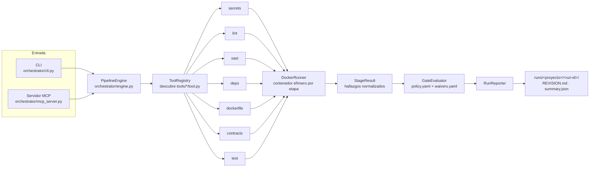

# Pipeline de revisión de servicios

Herramienta de apoyo al desarrollo que **revisa un servicio completo con una sola orden** y entrega un veredicto
verificable: **aprobado**, **rechazado** o **no se pudo revisar**. Corre cada análisis en un contenedor Docker
efímero, aplica una política explícita y deja un informe legible (`REVISION.md`) y otro para máquinas (`summary.json`).

Se puede usar de dos formas:

- **Desde la terminal**, como cualquier herramienta de CI.
- **Desde Claude** (Claude Code o Claude Desktop), como servidor MCP. Claude ejecuta la revisión, lee los hallazgos,
  consulta la guía de corrección de cada herramienta, corrige el código y vuelve a revisar hasta que el veredicto sea
  aprobado.

```text
review <proyecto>  ──►  secrets · lint · sast · deps · dockerfile · contracts · test  ──►  gate  ──►  APROBADO / RECHAZADO
```

---

## Índice

1. [Qué revisa](#1-qué-revisa)
2. [Principios](#2-principios)
3. [Arquitectura](#3-arquitectura)
4. [Requisitos e instalación](#4-requisitos-e-instalación)
5. [Configuración](#5-configuración)
6. [Uso desde la terminal](#6-uso-desde-la-terminal)
7. [Resultados de una corrida](#7-resultados-de-una-corrida)
8. [Uso desde Claude](#8-uso-desde-claude)
9. [Agregar una herramienta o un stack](#9-agregar-una-herramienta-o-un-stack)
10. [Pruebas del propio pipeline](#10-pruebas-del-propio-pipeline)
11. [Estado y limitaciones](#11-estado-y-limitaciones)

---

## 1. Qué revisa

### Etapas

| Etapa | Herramienta | Qué detecta | Bloquea cuando (`policy.yaml`) |
| --- | --- | --- | --- |
| `secrets` | Gitleaks | Credenciales, API keys y tokens en el código y en el historial git | Cualquier hallazgo (no admite excepciones) |
| `lint` | Linter del stack | Estilo, formato, errores estáticos y tipado | La etapa falla |
| `sast` | Semgrep + reglas propias | Patrones inseguros (inyección, deserialización, TLS desactivado, OWASP) | Severidad alta o crítica |
| `deps` | Trivy | CVEs en dependencias, licencias prohibidas (AGPL, SSPL) y SBOM CycloneDX | CVE alto con parche disponible, o licencia denegada |
| `dockerfile` | Hadolint | Malas prácticas y riesgos en el `Dockerfile` | Severidad `error` |
| `contracts` | Spectral, Buf | Calidad y reglas de estilo de contratos OpenAPI y Protobuf | La etapa falla |
| `test` | Toolchain del stack | Pruebas unitarias, número de pruebas y cobertura | Pruebas fallidas, 0 pruebas o cobertura bajo el mínimo (60 % por defecto) |

Todas las imágenes y versiones de herramientas están fijadas en `versions.env`, así que dos corridas sobre el mismo
código dan el mismo resultado.

### Stacks soportados

| Stack | Se detecta por | Lint | Pruebas y cobertura |
| --- | --- | --- | --- |
| `python` / `python_mcp` | `pyproject.toml`, `requirements.txt`, `setup.py`, `setup.cfg`, `Pipfile` | `ruff check` + `ruff format --check`; `mypy` si el servicio lo configura | `pytest` + `pytest-cov` (ramas) |
| `java_springboot` | `pom.xml`, `build.gradle` | Spotless | JUnit + JaCoCo |
| `go` | `go.mod` | `gofmt` + `go vet` | `go test -race` + cobertura sin código generado |
| `nestjs` / `node` / `frontend_react` | `package.json` | Script `lint` del proyecto + `tsc` | Jest / `node --test` |
| `ruby` | `Gemfile` | RuboCop | RSpec + SimpleCov |

La versión del toolchain sale del propio servicio cuando la declara (`go.mod`, `.python-version`, `requires-python`).
Si no la declara, se usa la de `versions.env`.

**Python sin configuración propia de Ruff:** se aplica la base del pipeline (`tools/lint/rules/python/ruff.toml`).
Cubre PEP 8, imports sin usar, bugbear, bandit (seguridad), `except` genéricos, código bloqueante en `async`, fechas
sin zona horaria y logging. Si el servicio trae su propia configuración, manda la del servicio.

---

## 2. Principios

1. **Efímero y aislado.** Cada etapa corre en un contenedor propio que se destruye al terminar. El código del servicio
   se monta **en solo lectura** y se trabaja sobre una copia; nunca se modifica el repositorio revisado ni se toca otro
   stack que esté corriendo en el equipo.
2. **Todas las etapas corren siempre.** Una etapa con problemas no detiene a las demás: el informe muestra todo de una vez.
3. **No ejecutado no es aprobado.** Una etapa que no pudo correr (`error`), que falta o que se omitió sin autorización
   **rechaza** la corrida. Ningún escaneo oculta su resultado con `|| true`.
4. **La política es explícita.** Qué bloquea y qué no se decide en `policy.yaml`, no dentro de cada herramienta.
5. **Las excepciones vencen.** Un hallazgo se puede exceptuar con responsable, motivo y fecha de vencimiento
   (`waivers.yaml`); al vencer, vuelve a bloquear.
6. **Identificadores estables.** Cada hallazgo tiene un ID (`etapa:regla:archivo:línea`) que permite seguirlo entre
   corridas y comparar antes y después de una corrección.

---

## 3. Arquitectura



### Flujo de una corrida

1. **Entrada.** La orden llega por la terminal (`cli.py`) o desde Claude (`mcp_server.py`). Ambas usan el mismo motor.
2. **Proyecto.** `PipelineEngine` busca el servicio en `projects.yaml` y crea `runs/<proyecto>/<run-id>/`.
3. **Etapas.** `ToolRegistry` descubre automáticamente cada `tools/<etapa>/tool.py`. Cada herramienta:
   - detecta el stack del servicio (o usa el declarado en `projects.yaml`);
   - copia el código a un volumen efímero, excluyendo `node_modules`, `.venv`, `target`, etc.;
   - corre su análisis en Docker y guarda los reportes crudos (SARIF, JSON, JUnit, SBOM) en la carpeta de la corrida;
   - convierte la salida en hallazgos normalizados (`Finding`) con severidad, archivo, línea y sugerencia de corrección.
4. **Veredicto.** `GateEvaluator` aplica `policy.yaml`, las excepciones vigentes de `waivers.yaml` y las reglas de
   cobertura, pruebas y etapas faltantes.
5. **Informe.** `RunReporter` escribe `REVISION.md` y `summary.json`, y la corrida se agrega a `runs/index.jsonl`.

### Estructura del repositorio

```text
.
├── core/                      Núcleo: contratos, ejecución en Docker, veredicto e informe
│   ├── base_tool.py           Contrato que implementa cada herramienta (run, skill, servidor MCP)
│   ├── models.py              Modelos: Finding, StageResult, RunSummary, ProjectConfig, Waiver
│   ├── registry.py            Descubrimiento automático de herramientas en tools/
│   ├── runner.py              DockerRunner: contenedores efímeros, rutas Windows/Linux, timeouts
│   ├── gate.py                Aplica policy.yaml y waivers.yaml y calcula el veredicto
│   ├── reporter.py            Genera REVISION.md y summary.json
│   └── versions.py            Lee versions.env (imágenes fijadas)
├── orchestrator/
│   ├── engine.py              PipelineEngine: corrida completa, por etapa y comparación de corridas
│   ├── cli.py                 Línea de comandos
│   └── mcp_server.py          Servidor MCP "review-orchestrator" para Claude
├── tools/<etapa>/             Una carpeta por etapa
│   ├── tool.py                Implementación (BaseTool)
│   ├── mcp_server.py          Servidor MCP individual de la etapa (opcional)
│   ├── rules/                 Reglas propias (Semgrep, Spectral, Ruff base…)
│   └── skills/SKILL.md        Guía de diagnóstico y corrección para agentes
├── tools/test_runner/stacks/  Perfiles por stack: detección, imagen, comandos de lint y pruebas
├── tests/                     Pruebas del pipeline y fixtures
├── policy.yaml                Qué bloquea en cada etapa
├── projects.example.yaml      Plantilla de servicios registrados (copiar a projects.yaml)
├── versions.env               Imágenes y versiones fijadas
├── .mcp.json                  Configuración MCP para Claude Code
└── PIPELINE_REVISION.md       Especificación de diseño completa
```

**Skills.** Cada herramienta trae una guía `SKILL.md` que explica sus reglas y cómo corregir cada hallazgo. Claude
la consulta con `get_tool_skill` antes de tocar el código, así las correcciones siguen el criterio del equipo y no
solo silencian la regla.

---

## 4. Requisitos e instalación

| Requisito | Versión | Para qué |
| --- | --- | --- |
| Docker (Docker Desktop en Windows/macOS) | Reciente, **en ejecución** | Todas las etapas corren en contenedores |
| Python | 3.11 o superior | Orquestador, CLI y servidor MCP |
| Git | Cualquiera | `secrets` revisa también el historial de commits |
| Claude Code o Claude Desktop | — | Solo si se usará desde Claude |

```bash
git clone https://github.com/spinol-p/PipeLine.git
cd PipeLine
python -m venv .venv
# Windows:  .venv\Scripts\activate      Linux/macOS:  source .venv/bin/activate
pip install -r requirements.txt
cp projects.example.yaml projects.yaml  # y registra tus servicios (ver sección 5)
python -m orchestrator.cli tools        # debe listar las 7 etapas
```

La primera corrida descarga las imágenes Docker y la base de vulnerabilidades de Trivy (~1,4 GB), así que tarda más.
Las siguientes reutilizan las cachés locales `review-cache-*` y `review-trivy-db`, que no se versionan.

---

## 5. Configuración

### `projects.yaml`: servicios registrados

`projects.yaml` es local de cada equipo y no se versiona. Créalo a partir del ejemplo:

```bash
cp projects.example.yaml projects.yaml      # Windows: copy projects.example.yaml projects.yaml
```

```yaml
projects:
  mi-servicio:
    path: C:/ruta/a/mi-servicio      # ruta absoluta al servicio
    stack: python            # opcional: si se omite, se detecta automáticamente
    default_mode: quick
    base: main               # rama base del servicio
    openapi_file: contracts/v1/mi_servicio.yaml   # opcional
    coverage_min: 80         # opcional: solo puede subir el mínimo de policy.yaml, nunca bajarlo
    allow_skipped_stages: [contracts]             # opcional: etapas que pueden omitirse sin rechazar
```

Por seguridad, Claude solo puede revisar proyectos registrados aquí.

### `policy.yaml`: qué bloquea

```yaml
stages:
  secrets:  { block_on: any }
  sast:     { block_on: high }
  deps:     { block_on: high, only_fixable: true, licenses_denied: [AGPL-3.0, SSPL-1.0] }
  test:     { block_on: fail, coverage_min: 60, require_tests: true }
on_stage_error: block       # una etapa que no pudo correr rechaza la corrida
on_missing_stage: block     # una etapa esperada sin reporte rechaza la corrida
```

### `versions.env`: imágenes fijadas

Una línea por imagen (`IMG_SEMGREP=semgrep/semgrep:1.90.0`). Se puede sobrescribir cualquier valor con una variable
de entorno del mismo nombre, por ejemplo para probar una versión nueva antes de actualizar el archivo.

### `waivers.yaml`: excepciones (en la raíz del servicio revisado)

```yaml
- id: "deps:CVE-2024-12345:requests@2.31.0"     # ID exacto del hallazgo, tal como aparece en REVISION.md
  reason: "Sin parche publicado; el endpoint afectado no está expuesto"
  owner: "nombre.apellido"
  expires: "2026-12-31"
```

Las excepciones vencidas se ignoran. Los hallazgos de `secrets` y los errores de etapa no se pueden exceptuar.

---

## 6. Uso desde la terminal

```bash
python -m orchestrator.cli list                              # proyectos registrados
python -m orchestrator.cli tools                             # etapas disponibles
python -m orchestrator.cli run mi-servicio                   # revisión completa
python -m orchestrator.cli run mi-servicio --base develop    # indicando otra rama base
python -m orchestrator.cli tool mi-servicio sast             # una sola etapa (secrets, lint, sast, deps, dockerfile, contracts, test_runner)
python -m orchestrator.cli compare mi-servicio <run_a> <run_b>   # qué se resolvió y qué es nuevo entre dos corridas
```

Ejemplo de salida:

```text
Veredicto: REJECTED  (bloqueantes: 3, exceptuados: 1)
  secrets     pass     0 hallazgo(s)
  lint        fail     2 hallazgo(s)
  sast        fail     1 hallazgo(s)
  ...
Informe: C:\ruta\al\pipeline\runs\mi-servicio\20261023-141502-a1b2c3\REVISION.md
```

**Códigos de salida de `run`:** `0` aprobado, `1` rechazado, `2` la revisión no pudo completarse. En un CI basta con
ejecutar la orden y dejar que el código de salida decida si el paso pasa.

---

## 7. Resultados de una corrida

```text
runs/
├── index.jsonl                      Una línea por corrida: proyecto, veredicto, bloqueantes, ruta del informe
└── <proyecto>/<run-id>/
    ├── REVISION.md                  Informe legible: resumen por etapa, hallazgos que bloquean y sugerencias
    ├── summary.json                 Mismo contenido para máquinas (veredicto, etapas, hallazgos)
    └── <etapa>/
        ├── result.json              Resultado normalizado de la etapa
        ├── stage.log                Salida completa de la herramienta
        └── report.sarif, sbom.cdx.json, junit.xml, coverage.json…   Reportes crudos
```

`runs/` es local y está en `.gitignore`: cada corrida se regenera.

---

## 8. Uso desde Claude

El servidor MCP `review-orchestrator` expone el pipeline a Claude. Corre **en tu equipo**, porque necesita Docker y
acceso a las carpetas de los servicios.

### 8.1 Claude Code dentro de este repositorio

El repositorio trae `.mcp.json`. Al abrir Claude Code en esta carpeta, se activa automáticamente; la primera vez pide
aprobar el servidor.

```bash
cd PipeLine
claude
> /mcp            # debe aparecer "review-orchestrator" conectado
```

Si usas un entorno virtual, cambia `"command": "python"` por la ruta a su intérprete
(`.venv/Scripts/python.exe` en Windows o `.venv/bin/python` en Linux/macOS).

### 8.2 Claude Code desde cualquier repositorio

Para revisar un servicio mientras trabajas en su propio repositorio, registra el servidor a nivel de usuario.
`PYTHONPATH` apunta a la carpeta del pipeline:

```bash
# Windows (PowerShell)
claude mcp add -s user -e PYTHONPATH=C:/ruta/al/pipeline review-orchestrator -- python -m orchestrator.mcp_server

# Linux / macOS
claude mcp add -s user -e PYTHONPATH=$HOME/PipeLine review-orchestrator -- python -m orchestrator.mcp_server
```

### 8.3 Claude Desktop

Edita `claude_desktop_config.json` (en Windows: `%APPDATA%\Claude\claude_desktop_config.json`; en macOS:
`~/Library/Application Support/Claude/claude_desktop_config.json`) y reinicia la aplicación:

```json
{
  "mcpServers": {
    "review-orchestrator": {
      "command": "python",
      "args": ["-m", "orchestrator.mcp_server"],
      "env": { "PYTHONPATH": "C:/ruta/al/pipeline" }
    }
  }
}
```

### 8.4 Herramientas que ve Claude

| Herramienta MCP | Qué hace |
| --- | --- |
| `list_projects` | Proyectos registrados en `projects.yaml` |
| `list_available_tools` | Etapas disponibles y si tienen guía (skill) |
| `run_certification(project_name, mode, base_ref)` | Revisión completa; devuelve veredicto, conteos y `run_id` |
| `run_tool(project_name, tool_name)` | Una sola etapa, para iterar rápido sobre un tipo de problema |
| `list_findings(project_name, run_id, stage, min_severity, blocking_only)` | Hallazgos filtrados, para no llenar el contexto |
| `get_tool_skill(tool_name)` | Guía de corrección de la etapa (`SKILL.md`) |
| `get_report(project_name, run_id)` | `REVISION.md` completo |
| `get_run_summary(project_name, run_id)` | `summary.json` completo |
| `compare_runs(project_name, run_a, run_b)` | Hallazgos resueltos, nuevos y persistentes entre dos corridas |

Cada etapa también tiene su propio servidor (`python -m tools.<etapa>.mcp_server`) por si se quiere exponer solo una.
Para el uso normal basta con `review-orchestrator`.

### 8.5 Flujo de trabajo recomendado con Claude

```text
run_certification ─► list_findings (solo bloqueantes) ─► get_tool_skill (de la etapa) ─► corregir el código
        ▲                                                                                      │
        └──────────── run_tool (la etapa corregida) ◄──────────────────────────────────────────┘
                                         │
                       run_certification final ─► compare_runs (antes vs. después)
```

### 8.6 Ejemplos de instrucciones

- *"Revisa `mi-servicio` con el pipeline y dime qué bloquea la aprobación."*
- *"Corrige los hallazgos bloqueantes de lint y sast de `mi-servicio`. Antes de cada corrección consulta el skill
  de la etapa. Vuelve a correr solo esas etapas hasta que pasen."*
- *"Sube la cobertura de `mi-servicio` sobre el 60 % escribiendo pruebas para los módulos con menos cobertura."*
- *"Compara la última corrida de `mi-servicio` con la anterior y confirma que no apareció ningún hallazgo nuevo."*
- *"¿Este CVE de `deps` tiene parche? Si no lo tiene, prepara la entrada de `waivers.yaml` para que yo la apruebe."*

> **Buenas prácticas al usarlo con Claude:** pide que corrija y vuelva a revisar en ciclos cortos, por etapa. Revisa
> tú las excepciones (`waivers.yaml`): Claude puede proponerlas, pero la decisión y la firma (`owner`) son humanas.

---

## 9. Agregar una herramienta o un stack

### Una etapa nueva

1. Crea `tools/<etapa>/tool.py` con una clase que herede de `BaseTool` e implemente `name`, `stage_name`,
   `description` y `run(project_path, run_dir, config) -> StageResult`. Usa `DockerRunner.run_container` y monta el
   código en solo lectura.
2. Agrega `tools/<etapa>/skills/SKILL.md` con las reglas y cómo corregir cada una.
3. Fija la imagen en `versions.env` y define qué bloquea en `policy.yaml`.
4. Si debe ser obligatoria, súmala a `expected_stages` en `core/gate.py`.

El registro la descubre sola; no hay que tocar el motor, el CLI ni el servidor MCP.

### Un stack nuevo

Agrega un perfil en `tools/test_runner/stacks/<stack>.json` con `detection_files`, `image` (o `image_env`),
`lint_cmd`, `test_cmd` y `cache_path`. Si las pruebas o el lint tienen un formato de salida propio, agrega su lectura
en `TestOutputParser` (`tools/test_runner/tool.py`) y en `LintTool._parse_lint_output` (`tools/lint/tool.py`).

---

## 10. Pruebas del propio pipeline

```bash
python -m unittest discover -s tests            # todas (las que requieren Docker se omiten si no está disponible)
PIPELINE_SKIP_DOCKER_TESTS=1 python -m unittest discover -s tests   # sin Docker
```

Cubren la lectura de cada herramienta, el veredicto del gate, la resolución de versiones y las reglas SAST propias
contra fixtures con casos inseguros y seguros.

---

## 11. Estado y limitaciones

- **Implementado:** modo `quick` con las 7 etapas descritas, CLI, servidor MCP, excepciones con vencimiento,
  comparación de corridas y soporte de Python, Java/Spring Boot, Go, Node/NestJS/React y Ruby.
- **Previsto:** cambios incompatibles de contratos contra la rama base (oasdiff/Buf breaking) y, en modo `full`,
  escaneo de la imagen construida, conformidad de la API en ejecución (Schemathesis) y prueba de humo. `policy.yaml` ya los menciona, pero hoy `--mode full` se registra en el informe sin agregar etapas.
- **Rutas:** `projects.yaml` usa rutas absolutas de cada equipo, por eso no se versiona.
- **Primera corrida lenta:** descarga imágenes y la base de Trivy. Las siguientes usan caché.

El diseño completo, las decisiones y las lecciones que lo originaron están en
[`PIPELINE_REVISION.md`](PIPELINE_REVISION.md).
